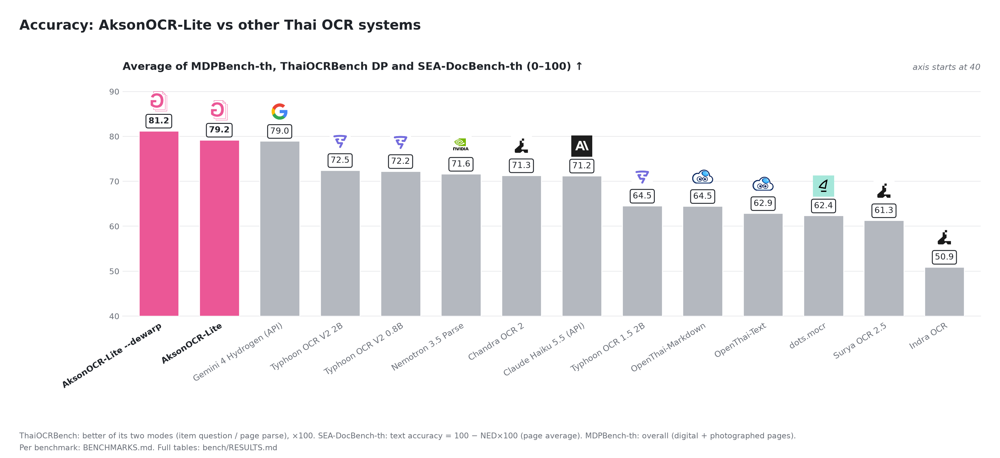
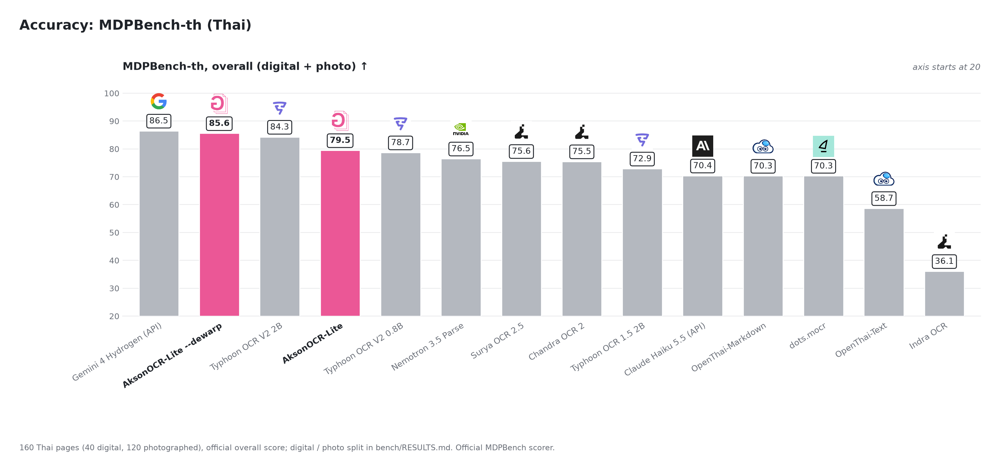
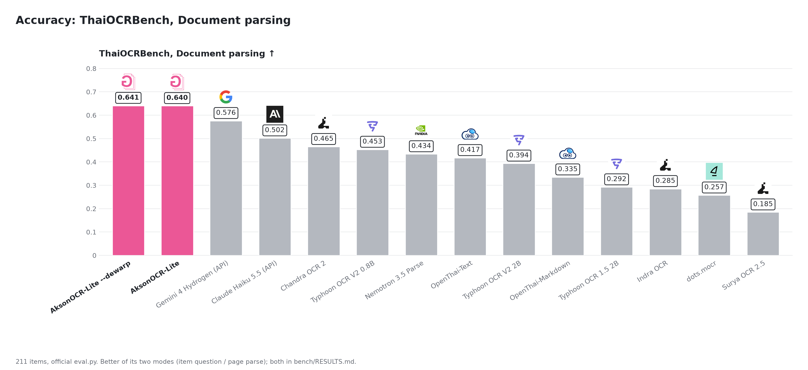
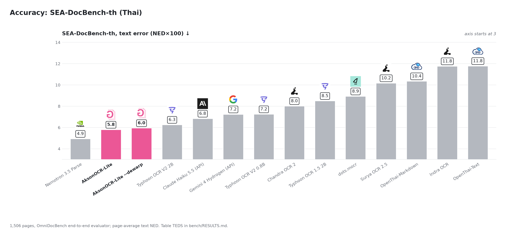
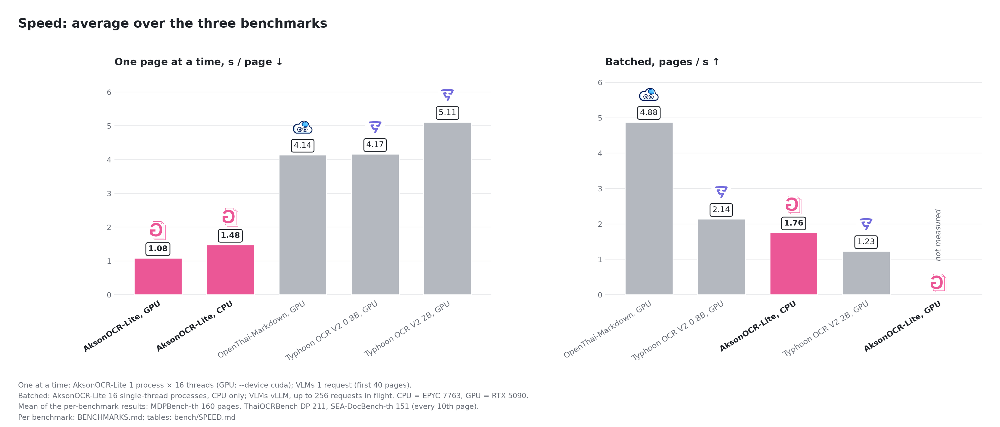
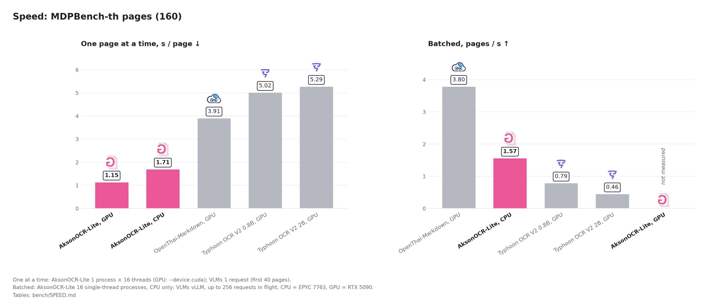
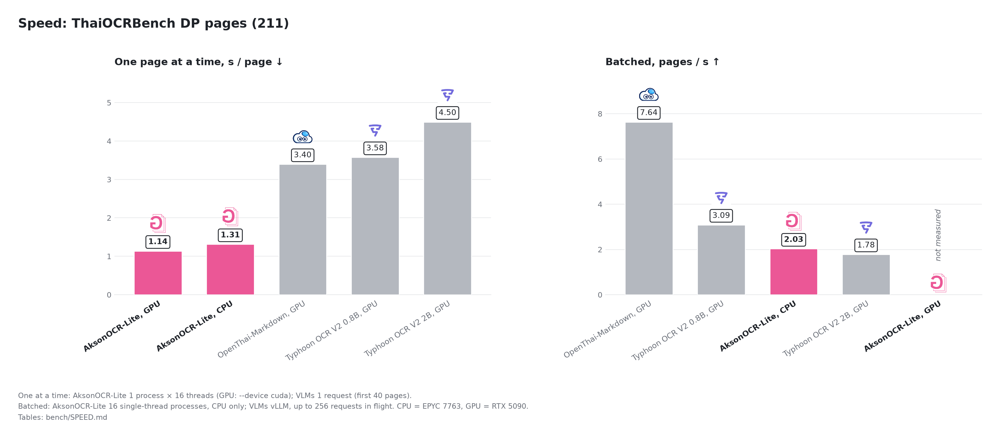
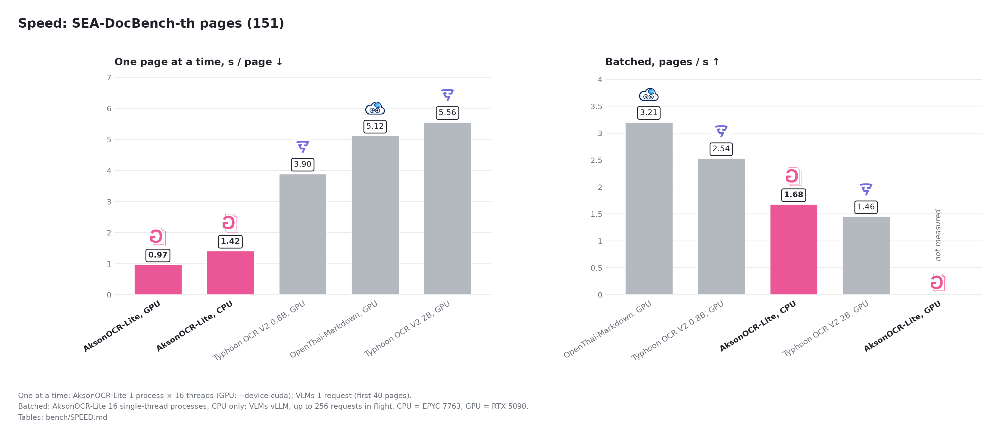
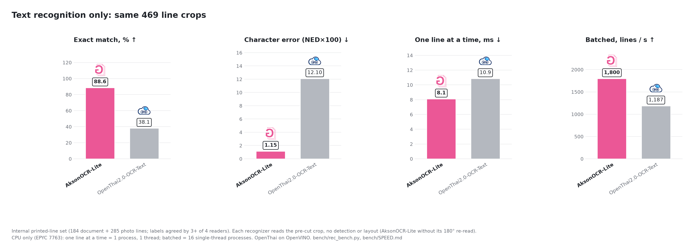

# AksonOCR-Lite benchmarks

[← back to README](README.md)

All numbers on this page: AksonOCR-Lite against 12 other Thai OCR systems (Typhoon OCR V2/1.5, OpenThai2.0,
Nemotron 3.5 Parse, dots.mocr, Chandra OCR 2, Surya OCR 2.5, Indra OCR, Gemini 4 Hydrogen, Claude Haiku 5.5), each
run as its authors recommend and scored by the same official scorers. How every system was run, and every column:
[bench/RESULTS.md](bench/RESULTS.md) (accuracy) and [bench/SPEED.md](bench/SPEED.md) (speed). Scripts:
[`bench/`](bench/). Logos (from each maker's Hugging Face profile) are trademarks of their owners and only identify
the system.

- [AksonOCR-Lite: default vs `--dewarp`](#aksonocr-lite-default-vs---dewarp)
- [Accuracy](#accuracy): average, MDPBench-th, ThaiOCRBench DP, SEA-DocBench-th
- [Speed](#speed): average, per benchmark
- [Text recognition only](#text-recognition-only)

## AksonOCR-Lite: default vs `--dewarp`

**MDPBench, Thai (160 pages: 40 digital, 120 photographed)**, official scorer:

| Setting | Overall ↑ | Digital ↑ | Photo ↑ |
|---|---:|---:|---:|
| `--dewarp` (recommended for photos) | **85.6** | 89.5 | 84.3 |
| default (no dewarp) | 79.5 | 89.5 | 76.2 |

With `--dewarp`, pages that already fill the image (scans, born-digital) are left unwarped; only photos with
background around the page are flattened.

| Benchmark | Metric | default | `--dewarp` |
|---|---|---:|---:|
| [ThaiOCRBench](https://github.com/scb-10x/ThaiOCRBench) — Document parsing (211 samples) | STEDS ↑ | 0.640 | **0.641** |
| [SEA-DocBench](https://huggingface.co/datasets/xingranzhao/SEA-Vision), Thai (1,506 pages) | text NED ↓ | **0.0580** | 0.0595 |
| SEA-DocBench, Thai | table TEDS ↑ | 0.749 | **0.757** |

## Accuracy

### Average of the three benchmarks

Three scores on a 0–100 scale, averaged: MDPBench-th (overall: 40 digital + 120 photographed pages), ThaiOCRBench Document parsing (×100; the better
of its two modes, item question / page parse) and SEA-DocBench-th text accuracy (100 − NED×100).

### MDPBench-th

### ThaiOCRBench, Document parsing

### SEA-DocBench-th

Speed vs accuracy as a scatter plot: [speed_accuracy_light.png](assets/charts/speed_accuracy_light.png).

## Speed

Default settings (no dewarp), timed end to end on each benchmark's pages: MDPBench-th 160 pages, ThaiOCRBench DP 211,
SEA-DocBench-th 151 (every 10th page). One at a time: AksonOCR-Lite 1 process × 16 threads, VLMs 1 request.
Batched: AksonOCR-Lite 16 single-thread processes on the CPU, VLMs vLLM with up to 256 requests in flight on one
RTX 5090. CPU: EPYC 7763.

### Average of the three benchmarks

| System | Hardware | s / page, one at a time | pages / s, batched |
|---|---|---:|---:|
| **AksonOCR-Lite** | CPU only (EPYC 7763) | **1.48** | **1.76** |
| **AksonOCR-Lite** | RTX 5090 (`--device cuda`) + CPU recognizer | **1.08** | – |
| OpenThai2.0-OCR-Markdown | RTX 5090, vLLM | 4.14 | 4.88 |
| Typhoon OCR V2 0.8B | RTX 5090, vLLM | 4.17 | 2.14 |
| Typhoon OCR V2 2B | RTX 5090, vLLM | 5.11 | 1.23 |

### MDPBench-th

### ThaiOCRBench, Document parsing

### SEA-DocBench-th

Per-benchmark tables, median/p90, per-stage split and token rates: [bench/SPEED.md](bench/SPEED.md).

## Text recognition only

The recognizer alone against the other Thai CPU line recognizer,
[OpenThai2.0-OCR-Text](https://huggingface.co/iapp/OpenThai2.0-OCR-Text), on the same 469 pre-cut line crops
(internal printed-line set, 184 document + 285 photo lines), no detection or layout, CPU only
([`bench/rec_bench.py`](bench/rec_bench.py)). AksonOCR-Lite here is the recognizer without its 180° re-read, which is
meant for upside-down lines in full pages; with it: [bench/SPEED.md](bench/SPEED.md#text-recognition-only).

| Recognizer | exact match % ↑ | character error (NED×100) ↓ | ms / line, 1 thread ↓ | lines / s, 16 processes ↑ |
|---|---:|---:|---:|---:|
| **AksonOCR-Lite** | **88.6** | **1.15** | **8.1** | **1,800** |
| OpenThai2.0-OCR-Text (OpenVINO) | 38.1 | 12.10 | 10.9 | 1,187 |
